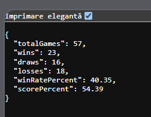
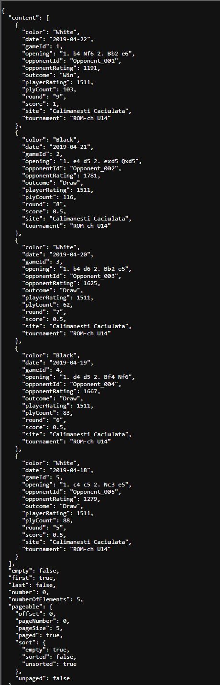
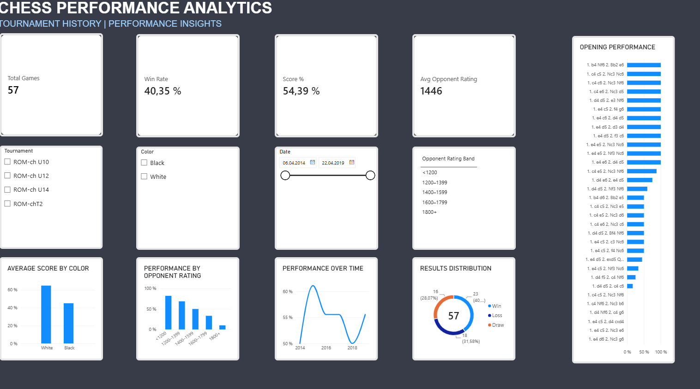
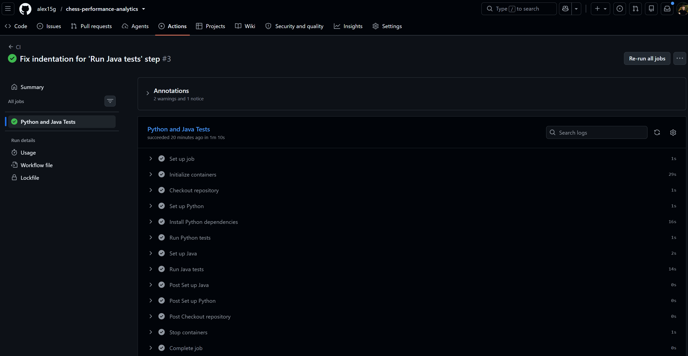

# Chess Performance Analytics

A personal analytics project that transforms chess tournament PGN files into structured data, stores game records in MySQL, exposes performance metrics through a Java Spring Boot REST API, and visualizes results in Power BI.

> **Data note:** The original PGN files, processed CSV, and Power BI report are intentionally not committed. The repository contains the processing code and backend; running the complete workflow requires a PGN dataset you are authorized to use.

## Project at a glance

- **Data engineering:** Python ETL with `python-chess` and `pandas`.
- **Storage:** MySQL 8.
- **Backend:** Java 17, Spring Boot, Spring Data JPA, Maven.
- **Analytics:** REST endpoints for overview, color, and opening statistics.
- **Visualization:** Power BI dashboard using the generated CSV and Power Query/DAX.
- **Quality:** Python and Java tests, with GitHub Actions CI on pushes and pull requests to `main`.

## Architecture


The workflow has two related outputs from the transformed game data:

1. `games.csv` can be loaded into Power BI for interactive analysis.
2. The same CSV can be imported into MySQL and queried through the Spring Boot API.

## Technology stack

| Area | Technologies |
|---|---|
| Data processing | Python 3.12, `python-chess`, `pandas`, CSV |
| Database | MySQL 8.4, Docker Compose |
| Backend API | Java 17, Spring Boot, Spring Data JPA, Maven |
| Dashboard | Power BI Desktop, Power Query, DAX |
| Testing and CI | pytest, JUnit 5, Mockito, GitHub Actions |

## Repository structure

```text
chess-performance-analytics/
├── .github/workflows/ci.yml         # Automated tests on GitHub
├── backend/chess-analytics-api/     # Spring Boot REST API and MySQL Compose setup
├── src/
│   ├── anonymize_pgn.py              # Replaces opponents' names with stable IDs
│   ├── etl.py                        # Parses PGN and produces a structured CSV
│   └── load_to_mysql.py              # Imports CSV rows into MySQL
├── tests/                            # Python unit tests
├── requirements.txt                  # Python dependencies
├── docs/images/architecture.svg      # Architecture diagram
└── README.md
```

## Dataset and metrics

The local development dataset contains **57 games**:

| Metric | Result |
|---|---:|
| Games processed | 57 |
| Wins | 23 |
| Draws | 16 |
| Losses | 18 |
| Win rate | 40.35% |
| Score percentage | 54.39% |
| Average opponent rating | approximately 1,446 |

These figures describe the dataset used during local development; the raw data is not distributed in this repository. Score percentage is calculated as `(wins + 0.5 × draws) / total games × 100`. Win rate is `wins / total games × 100`.

The ETL uses the PGN `Opening` header when it is available. Otherwise, it falls back to the first four individual moves; those fallback labels should not be interpreted as authoritative opening classifications.

## Requirements

For the full workflow, install:

- Git
- JDK 17
- Python 3.12
- Docker Desktop with Docker Compose
- Power BI Desktop (optional; only needed to inspect or rebuild the dashboard)

## Run locally (Windows / PowerShell)

### 1. Clone the repository

```powershell
git clone https://github.com/alex15g/chess-performance-analytics.git
cd chess-performance-analytics
```

### 2. Configure a PGN dataset

The repository does not include a PGN data file. Create a `data` directory and put your own PGN export in `data/games.pgn`:

```powershell
New-Item -ItemType Directory -Force data
```

The current scripts are configured for the project owner's dataset. Before processing your own file, update the `MY_NAME` constant in both `src/anonymize_pgn.py` and `src/etl.py` so that it exactly matches the player's name in your PGN headers. Do not commit private or identifying game files.

### 3. Install Python dependencies and generate the CSV

From the repository root:

```powershell
python -m pip install -r requirements.txt
python src/anonymize_pgn.py
python src/etl.py
```

Expected outputs:

- `data/games_anonymized.pgn` — opponent names replaced by stable IDs such as `Opponent_001`.
- `data/games.csv` — structured records for analysis and import.

The anonymizer does not make every match unidentifiable: tournament, date, rating, and move information may still allow games to be matched against public records. Review the output before sharing it.

### 4. Configure and start MySQL

Open a terminal in the backend project:

```powershell
cd backend/chess-analytics-api
Copy-Item .env.example .env
```

Edit `.env` and replace the example passwords with local development values. Keep `.env` private; it is ignored by Git.

Start MySQL:

```powershell
docker compose up -d
```

Check that the container is healthy:

```powershell
docker ps
```

### 5. Configure and start the Spring Boot API

In the same PowerShell terminal, set the connection variables to match the values in your `.env` file. For example:

```powershell
$env:DB_URL = "jdbc:mysql://localhost:3306/chess_analytics"
$env:DB_USERNAME = "chess_app"
$env:DB_PASSWORD = "replace_with_local_password"
```

Run the API from `backend/chess-analytics-api`:

```powershell
.\mvnw.cmd spring-boot:run
```

The application uses these environment variables to connect to MySQL. Hibernate is configured with `ddl-auto=update`, so the `games` table is created or updated when the application starts.

### 6. Import the generated CSV into MySQL

Open a **second** PowerShell terminal in the repository root and set the database variables for the Python loader. The password must match the `MYSQL_PASSWORD` value in the backend `.env` file.

```powershell
cd C:\path\to\chess-performance-analytics
$env:DB_HOST = "127.0.0.1"
$env:DB_PORT = "3306"
$env:DB_NAME = "chess_analytics"
$env:DB_USERNAME = "chess_app"
$env:DB_PASSWORD = "replace_with_local_password"
python src/load_to_mysql.py
```

**Current implementation limitation:** `load_to_mysql.py` validates that the CSV contains exactly 57 rows. If you use a dataset of a different size, update that validation to match your intended workflow before importing it.

### 7. Call the API




With the API running, these endpoints are available at `http://localhost:8080`:

| Method | Endpoint | Description |
|---|---|---|
| `GET` | `/api/stats/overview` | Overall counts, win rate, and score percentage |
| `GET` | `/api/stats/by-color` | Performance grouped by White and Black |
| `GET` | `/api/stats/by-opening?limit=10` | Top opening labels, limited to 1–20 results |
| `GET` | `/api/games?page=0&size=10` | Paginated game records |
| `GET` | `/api/games?tournament=Example&color=White` | Filter games by tournament and color |
| `GET` | `/api/games/1` | Retrieve a game by ID |

Examples using `curl`:

```bash
curl http://localhost:8080/api/stats/overview
curl "http://localhost:8080/api/stats/by-color"
curl "http://localhost:8080/api/stats/by-opening?limit=10"
curl "http://localhost:8080/api/games?page=0&size=10"
curl http://localhost:8080/api/games/1
```

The overview response for the current local dataset is expected to have this shape and values:

```json
{
  "totalGames": 57,
  "wins": 23,
  "draws": 16,
  "losses": 18,
  "winRatePercent": 40.35,
  "scorePercent": 54.39
}
```

The games endpoint validates pagination (`page >= 0`, `1 <= size <= 100`) and accepts only `White` or `Black` for `color`. Invalid inputs return HTTP 400; requesting a game ID that does not exist returns HTTP 404.

### 8. Power BI dashboard


The dashboard was built in Power BI Desktop using `data/games.csv`, with measures for game count, wins, draws, losses, win rate, score percentage, and average opponent rating. It includes analysis by date, color, opponent rating band, result, and opening label, plus slicers for tournament, color, and date.

The `.pbix` and source dataset are not committed because the report can embed user-specific data. To inspect or rebuild the dashboard, open Power BI Desktop and load the generated `data/games.csv`; recreate the measures and visuals in the local report, or use the original report file if you have it locally.

## Tests and Continuous Integration


Run the Python tests from the repository root:

```powershell
python -m pytest -q
```

Run the Java tests from the backend folder:

```powershell
cd backend/chess-analytics-api
.\mvnw.cmd clean test
```

GitHub Actions runs the Python and Java test suites on pushes and pull requests targeting `main`, and can also be started manually. The workflow starts a temporary MySQL service for the CI job; it does not connect to a developer's local database.

## Configuration and data safety

- Never commit `.env` or real credentials.
- Use local-only credentials for development and CI.
- Do not commit original PGN files, generated CSV files, or a Power BI report that embeds private data without reviewing them first.
- Stable opponent IDs reduce direct exposure of names but do not guarantee full anonymization of games.

## Current scope and future improvements

- Add API integration tests for HTTP responses and endpoint validation.
- Make the loader's expected row count configurable rather than hard-coded.
- Add verified screenshots of the Power BI dashboard and API responses.
- Consider adding a sample synthetic dataset for reproducible demos.

---

Built as a portfolio project combining data processing, relational storage, REST API development, and BI reporting.
